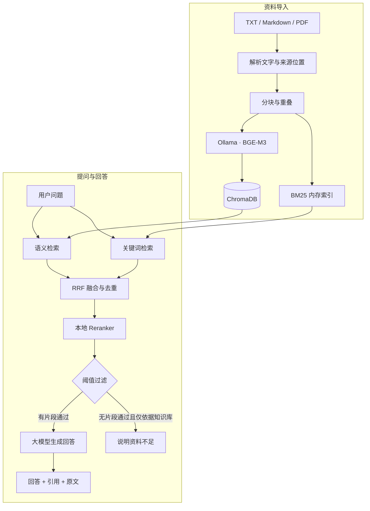

<div align="center">

# miniAgent

### 本地知识库助手

**把文档变成可检索、可引用的知识库。**

上传资料，提出问题，查看回答背后的原文依据。


[功能](#功能概览) · [快速开始](#快速开始) · [使用方法](#使用方法) · [检索参数](#检索参数) · [测试](#测试与评估)

</div>

---

## 项目介绍

miniAgent 是一个基于 Gradio 的个人知识库与 Agent 实践项目。它通过 Ollama 在本机运行 BGE-M3，
使用 ChromaDB 保存文档向量，将关键词检索、语义检索和本地重排组合成完整的 RAG 流程。

回答不仅给出结论，还展示引用的文件、位置和原文片段，便于核对依据。
在默认的“仅依据知识库回答”模式下，没有片段通过筛选时，程序会直接说明资料不足。

> **数据流说明：** 文档解析、向量生成、检索和重排都在本机完成。
> 用于生成回答的文本片段会发送到 `.env` 中配置的大模型服务；当前应用并非默认全离线运行。

## 功能概览

| 功能 | 说明 |
| :--- | :--- |
| 📚 文档导入 | 支持 TXT、Markdown、带文字层的 PDF，保存来源位置 |
| 🔎 混合检索 | BM25 匹配关键词，BGE-M3 匹配语义，通过 RRF 融合排名 |
| 🎯 本地重排 | BGE Reranker Base INT8 联合阅读问题与片段，在 CPU 上重新评分 |
| 🧭 依据筛选 | 按阈值过滤，支持限制参考片段数量与总长度 |
| 📎 来源引用 | 正文引用 `[资料1]`，展开即可查看文档位置和原文 |
| 🎛️ 可调参数 | 前端调整分块、重叠、召回数量、重排数量及阈值 |
| ♻️ 文档管理 | 同名更新、重复导入跳过、确认删除、回收站备份 |
| 💬 流式聊天 | 保存对话，压缩较长历史；可切换知识库检索与普通聊天 |
| 🛠️ Agent 工具 | 非严格知识库模式下可使用联网搜索、时间查询和项目内文件读写 |

## 工作流程



BM25 索引在第一次关键词检索时从已入库文本构建，后续复用；资料更新或删除后失效重建。
加入混合检索和重排不要求更换 ChromaDB，也不需要重新生成已有文档的向量。

## 快速开始

以下以 **Windows PowerShell** 和 `D:\miniAgent` 为例。先将仓库克隆或下载到该目录。

### 1. 准备环境

- 推荐 **Python 3.11**，这是项目当前验证使用的版本。
- 安装并启动 [Ollama](https://ollama.com/)。
- 准备支持 OpenAI 兼容 Chat Completions 接口的模型服务及 API Key。
- 首次安装依赖和下载模型需要联网。

BGE-M3 通过 Ollama 运行，可根据机器条件使用 CPU 或 GPU；重排默认使用 CPU，不需要额外安装 CUDA 或 PyTorch。

```powershell
Set-Location D:\miniAgent

# 新安装使用独立环境；已经配置好环境的用户可以直接复用。
python -m venv .venv
.\.venv\Scripts\python.exe -m pip install -r requirements-rag.txt
```

### 2. 准备本地模型

```powershell
# 已下载过的 embedding 模型可以直接复用。
ollama pull bge-m3

# 下载重排模型及 tokenizer，保存到项目 models/ 目录。
.\.venv\Scripts\python.exe src\setup_reranker.py
```

重排使用 [Xenova/bge-reranker-base](https://huggingface.co/Xenova/bge-reranker-base)
提供的 ONNX INT8 转换版。下载脚本固定模型版本并校验 SHA256，文件合计约 **296 MB**。
聊天请求不会自动下载模型。

如果 Ollama 尚未运行，可在另一个终端执行 `ollama serve`；已经启动时无需重复执行。

### 3. 配置模型服务

在项目根目录创建 `.env`，填入自己的服务地址和密钥：

```dotenv
# 以下地址与密钥均为占位示例，请替换。
OPENAI_API_KEY=your_model_api_key
OPENAI_BASE_URL=https://your-provider.example/v1

# 本地 embedding 配置
OLLAMA_BASE_URL=http://127.0.0.1:11434
RAG_EMBED_MODEL=bge-m3:latest

# 使用联网搜索时配置
TAVILY_API_KEY=your_tavily_api_key
```

**生成模型名称目前写在代码中**：`src/knowledge_assistant.py` 中主 Agent 和摘要 Agent
都使用 `model="deepseek-flash"`。如果你的服务不提供这个名称，请将这两处改为服务支持的模型 ID。
所选模型还需支持应用使用的流式输出和工具调用接口。

`.env` 不应上传到 GitHub；仓库已在 `.gitignore` 中排除它。

### 4. 启动应用

```powershell
.\.venv\Scripts\python.exe src\knowledge_assistant.py
```

浏览器访问 **[http://127.0.0.1:7860](http://127.0.0.1:7860)**。
默认只监听本机地址。

## 使用方法

### 导入与提问

1. 在“知识库管理”中选择资料，按需调整分块参数。
2. 点击“导入 / 更新资料”，等待导入结果。
3. 保持“优先检索知识库”和“仅依据知识库回答”开启，输入问题。
4. 查看正文引用，展开来源原文核对；需要排查检索效果时，打开候选分数表。

例如，资料中记录了设备维护周期，可以提问：

> 这台设备多久更换一次冷却液？请给出资料依据。

回答会使用 `[资料1]` 等编号关联本轮选中的片段。相关资料只支持问题的一部分时，
应用要求模型分别说明已知内容和缺失信息。

### 更新与删除

- **更新资料：** 同名文件视为同一文档，内容或分块设置变化后重新建立索引；旧原文保留在 `.versions/`。
- **重复导入：** 内容与分块设置均未变化时跳过。
- **删除资料：** 选择文档，核对清单并勾选确认，再点击“删除所选文档”。
- **恢复误删：** 找到 `data/trash/` 中的原文件，重新上传并导入。
- **清空聊天：** 只清除当前入口的聊天记录，不删除知识库。

删除会清理向量记录和 BM25 缓存，将原文件及索引快照保留在回收站。
已有聊天、旧版本副本和已经发送给模型服务的内容不会因此撤回；目前没有一键恢复或自动清空回收站功能。

## 检索参数

| 参数 | 默认值 | 作用 |
| :--- | :---: | :--- |
| 检索方式 | 混合检索 | 可切换为仅向量或仅 BM25，便于对比 |
| 每块最多字符数 | 1200 | 控制入库粒度，可调 200–4000 |
| 重叠字符数 | 180 | 减少块边界截断，必须小于块大小的一半 |
| 每路召回候选数 | 20 | BM25、向量两路各自召回，可调 10–60 |
| 最多重排候选数 | 20 | 控制精排成本，可调 10–40 |
| 重排最低分数 | 0.20 | 低于该值的片段不进入回答；关闭重排时不生效 |
| 最多参考片段数 | 4 | 最终给模型的片段上限，可调 1–10 |
| 参考原文总长 | 12000 字符 | 同时限制上下文体积，实际片段数可能少于设置上限 |

修改分块设置后需要重新导入对应文件；调整检索数量、重排和阈值不需要重新入库。

<details>
<summary><strong>如何理解分数与阈值？</strong></summary>

向量相似度、BM25 分数和 RRF 分数来自不同计算方式，不能直接比较大小。
重排分数通过 Sigmoid 映射到 0–1，**也不是答案正确概率**。

提高阈值通常会减少无关片段，也可能漏掉有效证据。默认 0.20 来自小型合成集校准，
真实资料应配合有答案、无答案和部分有答案的问题重新评估。

重排判断的是相关程度，不能证明资料包含问题所需的全部事实。即使片段通过阈值，
仍可能缺少品牌、日期或具体数值；正文结论需要与原文核对。

</details>

<details>
<summary><strong>仅依据知识库回答与普通聊天有什么区别？</strong></summary>

启用知识库检索且勾选“仅依据知识库回答”时：

- 没有片段通过筛选，程序直接说明资料不足，不调用生成模型或摘要模型。
- 有片段通过时，要求模型仅使用本轮资料，并禁用联网与文件工具。
- 历史对话不作为事实依据，缺失字段不能依靠常识补全。

关闭“仅依据知识库回答”后，恢复 Agent 的工具与普通回答能力。
关闭知识库检索后，这项限制也不生效。

</details>

## 项目结构

```text
miniAgent/
├── src/
│   ├── knowledge_assistant.py   # Gradio 界面、聊天与文档管理入口
│   ├── ingest.py                # 文档解析、分块、增量入库
│   ├── rag.py                   # 混合检索、过滤、来源与回收站管理
│   ├── rerank.py                # 本地 ONNX 重排推理
│   ├── setup_reranker.py        # 重排模型下载与完整性校验
│   └── ds*.py                  # 早期实验版本
├── tests/                      # 回归测试、网页验证与检索评估
│   └── fixtures/               # 合成资料及标注问题
├── knowledge/                  # 导入的原文件，运行时生成
├── data/
│   ├── chroma/                 # 持久化向量库
│   └── trash/                  # 回收站原文与恢复快照
├── models/                     # 本地重排模型
├── sessions/                   # 聊天记录
├── .cache/                     # 上传缓存、分词缓存与测试产物
├── .env                        # 本地配置，不应提交
├── requirements-rag.txt        # Python 依赖
├── README-RAG.md               # 详细实现与本机运维说明
└── README.md
```

运行目录以项目根目录为基准。Ollama 模型继续由 Ollama 管理，不会自动复制到 `models/`。

## 测试与评估

在项目根目录执行：

```powershell
# 回归测试：包含真实 Ollama 检索与本地模型测试。
.\.venv\Scripts\python.exe -B -m unittest discover -s tests -v

# 比较向量、BM25 和混合检索。
.\.venv\Scripts\python.exe -B tests\evaluate_retrieval.py

# 校准重排阈值，并使用保留问题验证。
.\.venv\Scripts\python.exe -B tests\evaluate_rerank.py

# 真实网页文档管理流程，不调用大模型。
.\.venv\Scripts\python.exe -B tests\smoke_document_management.py

# 网页回答、拒答和部分依据回答，会调用配置的大模型服务。
.\.venv\Scripts\python.exe -B tests\smoke_assistant.py
```

测试使用 `.cache/` 下的隔离资料和向量库，不操作用户正式知识库。
运行完整测试前需启动 Ollama；真实重排测试需要准备好本地模型。
网页验证分别使用本机 7862 和 7861 端口，请确保端口可用。

评估集包含 **6 份合成文档、10 个校准问题、8 个保留验证问题**，覆盖精确标识、语义改写、
多文档、无答案和部分有答案场景。报告保存在 `.cache/` 下。
这些结果用于回归与调参，不能等同于真实资料的回答准确率。

## 当前边界

- **文档：** 单文件不超过 30 MiB；扫描 PDF 需先 OCR，暂不支持 Word、Excel 或图片直接入库。
- **定位：** PDF 使用文件页序号，可能与印刷页码不同；Markdown 和 TXT 保留标题或行范围。
- **同名文件：** 作为同一文档更新，不同资料请使用不同文件名。
- **运行方式：** 面向单机、单进程；不支持多个进程同时维护同一库，也未提供用户隔离与登录功能。
- **重排长度：** 单窗口最多 512 token，长块使用重叠窗口；问题过长时重排仅使用前 128 token。
- **删除一致性：** 普通异常会尝试回滚，但文件系统与 Chroma 没有跨系统事务，突然中断可能需要根据回收站记录检查恢复。

## GitHub 提交说明

`.gitignore` 已排除密钥文件、原始资料、向量库、模型、聊天记录和缓存。
**此前已经被 Git 跟踪的文件不会因为新增忽略规则而自动排除。** 推送前可检查：

```powershell
git status --short
git ls-files .env sessions knowledge data models .cache
```

如第二条命令仍列出本地私有数据，应先从版本管理中移除；若敏感内容已提交过，
还需要检查历史记录。不要将真实 API Key 或私人资料作为示例上传。

---

<div align="center">

基于 [Gradio](https://www.gradio.app/) · [Ollama](https://ollama.com/) · [ChromaDB](https://www.trychroma.com/) · [BGE](https://github.com/FlagOpen/FlagEmbedding) · [ONNX Runtime](https://onnxruntime.ai/)

更详细的实现与维护说明见 [README-RAG.md](README-RAG.md)。

</div>
