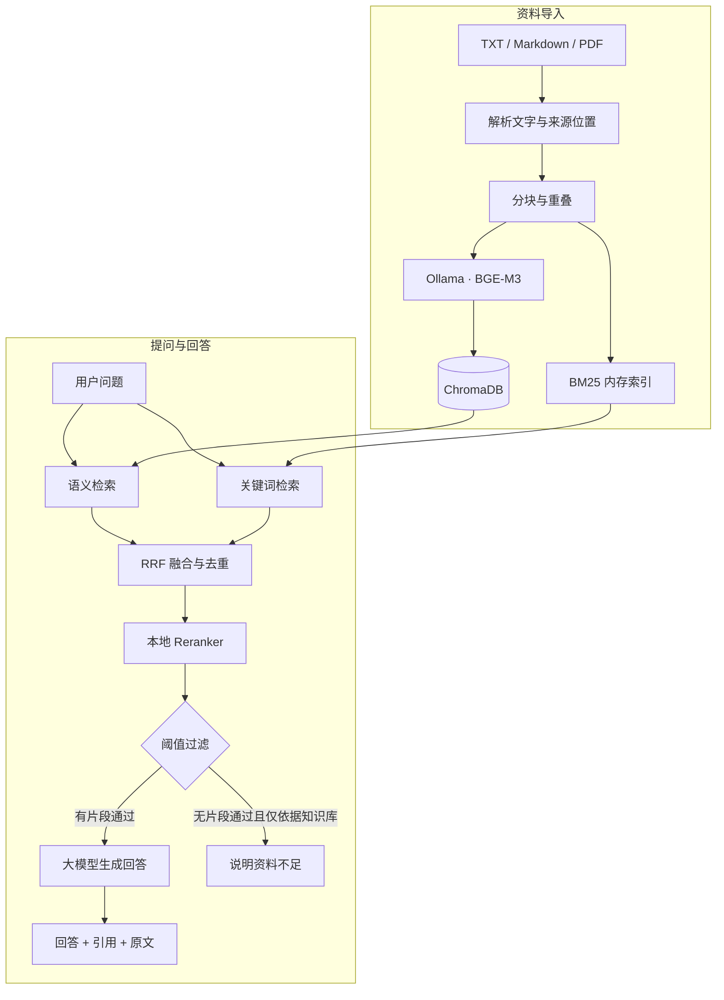

<div align="center">

# miniAgent

### 从一次模型调用，到带记忆和知识库的智能体

**沿着代码版本学习 Agent，也可以直接运行当前的知识库助手。**

上传资料，提出问题，查看回答背后的原文依据。


[学习路线](#学习路线) · [功能](#功能概览) · [部署要求](#部署要求) · [快速开始](#快速开始) · [使用方法](#使用方法) · [测试](#测试与评估)

</div>

---

## 项目介绍

miniAgent 记录了一个 Python 智能体逐步完善的过程：先用 `local.py` 尝试本地模型调用，
再通过 `ds.py` 到 `ds6.py` 接入云端模型，逐步加入工具、多轮对话、历史保存、上下文压缩和网页界面。
这些阶段代码保留在仓库中，方便按顺序阅读、运行和比较。

当前入口是 `src/knowledge_assistant.py`。它在前面各阶段的基础上加入文档知识库：
通过 Ollama 在本机运行 BGE-M3，使用 ChromaDB 保存向量，结合 BM25、RRF 融合和本地重排检索资料，
再交给配置的模型服务生成回答。聊天历史已从 JSON 迁移到 SQLite。

回答中可查看引用的文件、位置和原文片段，便于核对依据。
在默认的“仅依据知识库回答”模式下，没有片段通过筛选时，程序会直接说明资料不足。

> **数据流说明：** 文档解析、向量生成、检索和重排都在本机完成。
> 用于生成回答的文本片段会发送到 `.env` 中配置的大模型服务；当前应用并非默认全离线运行。

## 学习路线

建议先看每个文件的 Agent 定义、工具函数和请求入口，再比较它如何管理消息。
这些文件是独立的阶段示例，当前版本不会依次调用它们。

| 阶段 | 文件 | 这一阶段增加了什么 | 阅读重点 |
| :--- | :--- | :--- | :--- |
| 本地尝试 | [local.py](src/local.py) | 用 Ollama 的 `qwen3.5:4b` 回答一个固定问题 | `Agent`、`Runner.run_sync` 与本地服务地址 |
| 云端调用 | [ds.py](src/ds.py) | 改用 `deepseek-flash`，注册时间工具，流式输出固定问题的回答 | 模型如何调用 Python 函数，如何接收流式事件 |
| 多轮对话 | [ds2.py](src/ds2.py) | 增加终端输入循环，将用户消息和助手回答放入历史列表 | 下一轮为什么要传入历史，以及内存中的历史为何不会跨进程保留 |
| 扩展工具 | [ds3.py](src/ds3.py) | 加入 Tavily 搜索、本地文件读写，并在常驻事件循环中处理每轮请求 | 工具描述、参数和返回文本如何参与回答 |
| 调用约束 | [ds4.py](src/ds4.py) | 增加路径检查、低温度、强制工具调用，以及工具调用和结果的终端展示 | `tool_choice="required"` 的作用与局限 |
| 保存与压缩 | [ds5.py](src/ds5.py) | 保存 JSON 历史，加入摘要 Agent 和清空命令，取消强制工具调用 | 持久化、上下文长度与工具选择之间的关系 |
| 网页交互 | [ds6.py](src/ds6.py) | 改用 Gradio，展示流式回答、可折叠的过程信息和用时，兼容历史消息格式 | 前端历史与模型上下文如何分开，以及文件路径校验如何改进 |
| 当前应用 | [knowledge_assistant.py](src/knowledge_assistant.py) | 接入 RAG、混合检索、重排、引用、SQLite、文档管理、配置和自检 | 如何把阶段示例拆成可维护的模块 |

### 从“能回答”到“能连续交互”

`local.py` 先验证最小调用链：定义模型和指令，调用 `Runner`，打印结果。
`ds.py` 将模型换成云端服务，并给它一个真实的时间工具。这个阶段运行的是代码里预设的问题，
尚未提供循环输入。

`ds2.py` 开始接收终端输入。每轮把用户问题追加到列表，再把完整历史传给模型，回答结束后保存助手文本。
此时“记忆”只是进程中的 Python 列表，退出程序就会丢失。

### 从工具调用到调用约束

`ds3.py` 让模型能够联网查资料、读写文件。这里可以观察到 Agent 的基本工作方式：
模型提出工具调用，Python 执行函数，工具结果回到模型，模型继续回答。

`ds4.py` 尝试用更严格的提示词、路径检查和 `tool_choice="required"` 约束调用，并展示工具事件。
强制调用适合观察机制，但也可能让普通问题触发多余工具；`ds5.py` 取消了强制要求，
保留低温度和明确的调用规则。这几版适合对照阅读，理解一次设计选择为何会在后面调整。

`ds3.py` 没有目录访问限制；`ds4.py`、`ds5.py` 使用写死的 `D:\miniAgent` 和字符串前缀检查，
存在路径边界局限。`ds6.py` 改为根据项目位置计算目录，并使用规范化路径和 `commonpath` 检查。
学习旧版文件工具时请使用可覆盖的测试文件，不要把早期检查当作完整的安全隔离。

### 从历史记录到当前知识库

`ds5.py` 将历史写入 `sessions/history.json`，超过 12 条消息时压缩较早内容，保留最近 4 条原文，
支持 `/clear`、`/forget` 清空记录。`ds6.py` 沿用 JSON 和这组压缩参数，增加网页交互；
模型只接收正式回答，界面可以显示额外的过程信息。过程信息是否出现，取决于服务实际返回的事件。

当前知识库版本在此基础上继续完善：

- 将导入、检索、重排和存储拆成独立模块。
- 用 BM25 补充型号、错误码等关键词匹配，用 BGE-M3 处理语义匹配。
- 对融合候选重排、过滤，并让回答引用实际检索到的原文。
- 提供文档更新、删除确认和回收站。
- 使用 SQLite 保存完整短期聊天历史；上下文超过 30 条时压缩旧消息，保留最近 8 条原文。
- 将服务和模型配置集中到 `.env`，增加启动自检、日志、测试与 CI。

这里的短期记忆指聊天历史保存与上下文组织。目前没有自动提取用户偏好或长期事实的记忆系统。

### 如何运行阶段示例

先按下方部署步骤准备 Python 环境。阶段示例不需要 BGE-M3、Chroma 文档索引或重排模型；
这些依赖属于当前知识库版本。

**本地试跑：** 确保 Ollama 正在运行，并准备 `qwen3.5:4b`。在一个单独的 PowerShell 终端执行：

```powershell
Set-Location D:\miniAgent
ollama pull qwen3.5:4b
$env:OPENAI_BASE_URL = "http://127.0.0.1:11434/v1"
$env:OPENAI_API_KEY = "ollama"
.\.venv\Scripts\python.exe -c "from agents import set_default_openai_api, set_tracing_disabled; import runpy; set_default_openai_api('chat_completions'); set_tracing_disabled(True); runpy.run_path('src/local.py', run_name='__main__')"
```

这里的 `ollama` 是客户端要求的非空占位值，并非云端密钥。包装命令显式选择 Chat Completions，
因为原始 `local.py` 没有设置 API 模式；本地模型需要与源码中的模型名一致。

**云端阶段：** 关闭上面的试跑终端，另开终端，使用根目录 `.env` 配置云端服务地址、密钥和 Tavily。
`local.py`、`ds.py` 到 `ds6.py` 尚未接入统一配置模块，云端模型名仍写在源码中；
如果服务不提供 `deepseek-flash`，需修改对应文件中的 `model`，`ds5.py` 和 `ds6.py` 还需修改摘要模型。
`CHAT_MODEL`、`SUMMARY_MODEL` 只对当前知识库入口生效。

```powershell
Set-Location D:\miniAgent
# 从 ds.py 开始；学习下一阶段时，将文件名换成 ds2.py、ds3.py、ds4.py 或 ds5.py。
.\.venv\Scripts\python.exe -c "from agents import set_default_openai_api; import runpy; set_default_openai_api('chat_completions'); runpy.run_path('src/ds.py', run_name='__main__')"

# ds6.py 已显式选择 Chat Completions，可以直接运行。
.\.venv\Scripts\python.exe src\ds6.py
```

终端交互版本可用 `quit`、`exit` 或“退出”结束。`ds5.py` 和 `ds6.py` 共用 `sessions/history.json`，
会影响彼此读取的历史；当前入口使用独立的 SQLite 数据库。不要同时启动两个占用 7860 端口的网页版本。

这些旧脚本保留了各阶段的实现方式。接口、模型名称和输出事件需要与实际服务匹配，
不能仅凭 OpenAI 兼容地址就认定所有功能均可用。

## 功能概览

| 功能 | 说明 |
| :--- | :--- |
| 📚 文档导入 | 支持 TXT、Markdown、带文字层的 PDF，保存来源位置 |
| 🔎 混合检索 | BM25 匹配关键词，BGE-M3 匹配语义，通过 RRF 融合排名 |
| 🎯 本地重排 | BGE Reranker Base INT8 联合阅读问题与片段，在 CPU 上重新评分 |
| 🧭 依据筛选 | 按阈值过滤，支持限制参考片段数量与总长度 |
| 📎 来源引用 | 正文引用 `[资料1]`，展开即可查看文档位置和原文 |
| 🎛️ 可调参数 | 前端调整分块、重叠、召回数量、重排数量及阈值 |
| ♻️ 文档管理 | 同名更新、重复导入跳过、确认删除、回收站备份 |
| 💬 流式聊天 | 使用 SQLite 保存短期会话，压缩较长历史；可切换知识库检索与普通聊天 |
| 🛠️ Agent 工具 | 非严格知识库模式下可使用联网搜索、时间查询和项目内文件读写 |

## 工作流程



BM25 索引在第一次关键词检索时从已入库文本构建，后续复用；资料更新或删除后失效重建。
加入混合检索和重排不要求更换 ChromaDB，也不需要重新生成已有文档的向量。

## 部署要求

可以按学习进度准备环境，不必一开始就下载全部模型。

| 运行阶段 | 需要准备什么 | 是否需要知识库模型 |
| :--- | :--- | :--- |
| `local.py` | Python、OpenAI Agents SDK、python-dotenv、Ollama 和 `qwen3.5:4b` | 不需要 |
| `ds.py`、`ds2.py` | Python、Agents SDK、python-dotenv、云端模型地址和密钥 | 不需要 |
| `ds3.py` 至 `ds5.py` | 上述云端环境、tavily-python；联网搜索另需 Tavily Key | 不需要 |
| `ds6.py` | 上述云端环境，再加 Gradio | 不需要 |
| 当前知识库助手 | `requirements-rag.txt` 中的依赖、云端模型服务、Ollama BGE-M3、本地重排模型 | 需要 |

- **Python：** 推荐 64 位 Python 3.11，这是项目当前验证使用的版本。下面的命令以 Windows PowerShell 为准；Linux、macOS 需要调整虚拟环境路径，本文未提供这些平台的实测结果。
- **模型接口：** 云端服务需支持 OpenAI 兼容的 Chat Completions、流式输出和工具调用。`deepseek-flash` 是代码中的默认模型标识，实际可用名称以服务商为准。
- **本地推理：** BGE-M3 通过 Ollama 运行，可使用 CPU 或受支持的 GPU。重排使用 ONNX Runtime 在 CPU 上运行，无需额外安装 PyTorch 或 CUDA。
- **磁盘与内存：** 需要容纳 Python 环境、Ollama 模型、约 296 MB 的重排文件，以及导入的原文、向量库和备份。项目尚未测定统一的最低内存要求，CPU 推理速度也会随机器和资料规模变化。
- **网络：** 首次安装依赖和下载模型需要联网；之后生成回答仍需访问配置的模型服务。Tavily 只用于联网搜索，未配置不影响本地 RAG。

本地检索不等于全部数据留在本机：问题、参与回答的历史和检索片段会发送到配置的模型服务。项目默认用于单机、单进程使用，尚未提供账号登录和用户间的数据隔离。

## 快速开始

以下以 **Windows PowerShell** 和 `D:\miniAgent` 为例。先将仓库克隆或下载到该目录。

### 1. 准备环境

安装 [Python 3.11](https://www.python.org/downloads/) 和 [Ollama](https://ollama.com/)，准备好模型服务的 API Key。先确认现有 Python 版本，再创建项目虚拟环境；如果已经有可用环境，可以复用。

```powershell
Set-Location D:\miniAgent

py -3.11 --version
py -3.11 -m venv .venv
.\.venv\Scripts\python.exe -m pip install -r requirements-rag.txt
```

这里直接调用虚拟环境中的 Python，无需执行激活脚本。如果没有 Windows 的 `py` 启动器，可以用已确认版本为 3.11 的 `python` 替代。只学习早期示例时，可以按上方部署要求安装对应依赖；完整安装则可以运行仓库各阶段的代码。

虚拟环境和项目数据保存在 `D:\miniAgent`。Ollama 的模型目录由 Ollama 单独管理，安装依赖所用的 pip 缓存也不随项目目录自动迁移。

### 2. 准备本地模型

```powershell
# 已下载过的 embedding 模型可以直接复用。
ollama list
ollama pull bge-m3

# 下载重排模型及 tokenizer，保存到项目 models/ 目录。
.\.venv\Scripts\python.exe src\setup_reranker.py
```

重排使用 [Xenova/bge-reranker-base](https://huggingface.co/Xenova/bge-reranker-base)
提供的 ONNX INT8 转换版。下载脚本固定模型版本并校验 SHA256，文件合计约 **296 MB**。
聊天请求不会自动下载模型。

如果 Ollama 尚未运行，可在另一个终端执行 `ollama serve`；已经启动时无需重复执行。

### 3. 配置模型服务

首次配置时，复制项目根目录的 `.env.example` 为 `.env`；已有 `.env` 的用户直接编辑原文件：

```powershell
if (-not (Test-Path .env)) { Copy-Item .env.example .env }
notepad .env
```

至少检查以下配置。示例中的地址、密钥和模型名需要替换成服务商实际提供的值：

```dotenv
OPENAI_API_KEY=your_model_api_key
OPENAI_BASE_URL=https://your-openai-compatible-provider.example/v1
CHAT_MODEL=deepseek-flash
SUMMARY_MODEL=deepseek-flash

OLLAMA_BASE_URL=http://127.0.0.1:11434
RAG_EMBED_MODEL=bge-m3:latest
RAG_RERANK_MODEL_DIR=./models/bge-reranker-base

# 可选；仅在需要联网搜索时填写
TAVILY_API_KEY=
```

主 Agent 和摘要 Agent 的模型由 `CHAT_MODEL`、`SUMMARY_MODEL` 配置，不需要修改源码。
所选模型还需支持应用使用的流式输出和工具调用接口。

注意区分两种地址：`OPENAI_BASE_URL` 是生成模型的兼容接口地址，通常含 `/v1`；`OLLAMA_BASE_URL` 是 Ollama 服务地址，不含 `/v1`。环境变量优先于 `.env`，如果刚做过本地模型试跑，建议另开终端再启动云端版本。

如果自定义了重排模型目录，请在修改 `.env` 后重新运行 `src/setup_reranker.py`，让下载位置与配置一致。

`.env` 不应上传到 GitHub；仓库已在 `.gitignore` 中排除它。

### 4. 启动应用

```powershell
# 先检查配置和本地服务，不会发送计费的生成请求。
.\.venv\Scripts\python.exe src\startup_check.py

# 启动网页应用。
.\.venv\Scripts\python.exe src\knowledge_assistant.py
```

浏览器访问 **[http://127.0.0.1:7860](http://127.0.0.1:7860)**。
默认只监听本机地址。

启动时会执行只读自检，检查 Ollama embedding、重排模型、生成模型配置和 ChromaDB 状态。
自检只检查生成模型地址和密钥是否已配置，不会验证密钥、模型名称或工具调用能力；首次提问时才能检验实际接口是否可用。
运行日志写入 `data/logs/miniagent.log`，不会记录问题正文、API Key 或检索原文。

在终端按 `Ctrl+C` 停止应用。需要更换网页端口时，在 `.env` 中设置 `APP_PORT`；配置修改后需要重启。

### 常见问题

| 现象 | 检查方法 |
| :--- | :--- |
| 提示找不到 Python 包 | 确认安装和启动都使用 `.venv\Scripts\python.exe`，不要混用全局 Python |
| Ollama 无法连接或找不到模型 | 确认 Ollama 正在运行，用 `ollama list` 核对模型名称，并检查 `OLLAMA_BASE_URL` |
| 提示缺少重排模型 | 运行 `src/setup_reranker.py`，检查配置目录中的 `onnx/model_int8.onnx` 和 `tokenizer.json` |
| 云端请求出现 401、404 或工具调用错误 | 核对密钥、兼容接口地址、模型 ID，以及服务商对流式输出和工具调用的支持 |
| 早期示例请求 Responses 接口失败 | 使用学习路线中的 Chat Completions 包装命令，或在学习时显式设置 API 模式 |
| 网页无法启动，提示端口占用 | 关闭其他占用 7860 的实例，或修改 `APP_PORT` 后重启当前入口 |
| PDF 导入后没有文字 | 检查是否为扫描件；当前解析不包含 OCR |
| 有候选资料却提示依据不足 | 查看候选分数与原文，确认文档是否含答案，再结合真实问题调整阈值和分块 |

## 使用方法

### 导入与提问

1. 在“知识库管理”中选择资料，按需调整分块参数。
2. 点击“导入 / 更新资料”，等待导入结果。
3. 保持“优先检索知识库”和“仅依据知识库回答”开启，输入问题。
4. 查看正文引用，展开来源原文核对；需要排查检索效果时，打开候选分数表。

例如，资料中记录了设备维护周期，可以提问：

> 这台设备多久更换一次冷却液？请给出资料依据。

回答会使用 `[资料1]` 等编号关联本轮选中的片段。相关资料只支持问题的一部分时，
应用要求模型分别说明已知内容和缺失信息。

### 更新与删除

- **更新资料：** 同名文件视为同一文档，内容或分块设置变化后重新建立索引；旧原文保留在 `.versions/`。
- **重复导入：** 内容与分块设置均未变化时跳过。
- **删除资料：** 选择文档，核对清单并勾选确认，再点击“删除所选文档”。
- **恢复误删：** 找到 `data/trash/` 中的原文件，重新上传并导入。
- **清空聊天：** 只清除当前入口的聊天记录，不删除知识库。

删除会清理向量记录和 BM25 缓存，将原文件及索引快照保留在回收站。
已有聊天、旧版本副本和已经发送给模型服务的内容不会因此撤回；目前没有一键恢复或自动清空回收站功能。

## 检索参数

| 参数 | 默认值 | 作用 |
| :--- | :---: | :--- |
| 检索方式 | 混合检索 | 可切换为仅向量或仅 BM25，便于对比 |
| 每块最多字符数 | 1200 | 控制入库粒度，可调 200–4000 |
| 重叠字符数 | 180 | 减少块边界截断，必须小于块大小的一半 |
| 每路召回候选数 | 20 | BM25、向量两路各自召回，可调 10–60 |
| 最多重排候选数 | 20 | 控制精排成本，可调 10–40 |
| 重排最低分数 | 0.20 | 低于该值的片段不进入回答；关闭重排时不生效 |
| 最多参考片段数 | 4 | 最终给模型的片段上限，可调 1–10 |
| 参考原文总长 | 12000 字符 | 同时限制上下文体积，实际片段数可能少于设置上限 |

修改分块设置后需要重新导入对应文件；调整检索数量、重排和阈值不需要重新入库。

<details>
<summary><strong>如何理解分数与阈值？</strong></summary>

向量相似度、BM25 分数和 RRF 分数来自不同计算方式，不能直接比较大小。
重排分数通过 Sigmoid 映射到 0–1，**也不是答案正确概率**。

提高阈值通常会减少无关片段，也可能漏掉有效证据。默认 0.20 来自小型合成集校准，
真实资料应配合有答案、无答案和部分有答案的问题重新评估。

重排判断的是相关程度，不能证明资料包含问题所需的全部事实。即使片段通过阈值，
仍可能缺少品牌、日期或具体数值；正文结论需要与原文核对。

</details>

<details>
<summary><strong>仅依据知识库回答与普通聊天有什么区别？</strong></summary>

启用知识库检索且勾选“仅依据知识库回答”时：

- 没有片段通过筛选，程序直接说明资料不足，不调用生成模型或摘要模型。
- 有片段通过时，要求模型仅使用本轮资料，并禁用联网与文件工具。
- 历史对话不作为事实依据，缺失字段不能依靠常识补全。

关闭“仅依据知识库回答”后，恢复 Agent 的工具与普通回答能力。
关闭知识库检索后，这项限制也不生效。

</details>

## 项目结构

```text
miniAgent/
├── src/
│   ├── local.py                 # 本地模型：最小调用示例
│   ├── ds.py                    # 云端模型：时间工具与流式输出
│   ├── ds2.py                   # 终端多轮对话
│   ├── ds3.py                   # 联网搜索与文件读写
│   ├── ds4.py                   # 工具约束与调用过程展示
│   ├── ds5.py                   # JSON 历史与上下文压缩
│   ├── ds6.py                   # Gradio 网页交互
│   ├── knowledge_assistant.py   # Gradio 界面、聊天与文档管理入口
│   ├── ingest.py                # 文档解析、分块、增量入库
│   ├── rag.py                   # 混合检索、过滤、来源与回收站管理
│   ├── rerank.py                # 本地 ONNX 重排推理
│   ├── setup_reranker.py        # 重排模型下载与完整性校验
│   ├── memory_store.py          # SQLite 短期记忆与旧 JSON 迁移
│   ├── config.py                # 统一配置与日志
│   └── startup_check.py         # 本地服务、模型文件与配置检查
├── .github/workflows/ci.yml     # GitHub Actions 自动检查
├── tests/                      # 回归测试、网页验证与检索评估
│   └── fixtures/               # 合成资料及标注问题
├── knowledge/                  # 导入的原文件，运行时生成
├── data/
│   ├── chroma/                 # 持久化向量库
│   ├── logs/                   # 运行日志
│   ├── memory.sqlite3          # SQLite 短期记忆
│   └── trash/                  # 回收站原文与恢复快照
├── models/                     # 本地重排模型
├── sessions/                   # 阶段示例的 JSON 历史及迁移前备份
├── .cache/                     # 上传缓存、分词缓存与测试产物
├── .env                        # 本地配置，不应提交
├── .env.example                # 可复制的配置模板
├── requirements-rag.txt        # Python 依赖
├── README-RAG.md               # 详细实现与本机运维说明
└── README.md
```

运行目录以项目根目录为基准。Ollama 模型继续由 Ollama 管理，不会自动复制到 `models/`。

## 配置项

当前知识库助手的服务与模型配置集中在 `src/config.py`，通过 `.env` 设置；早期阶段示例的差异见学习路线：

| 变量 | 默认值 | 说明 |
| :--- | :--- | :--- |
| `OPENAI_API_KEY` | 无 | 生成模型服务密钥 |
| `OPENAI_BASE_URL` | 无 | OpenAI 兼容 Chat Completions 地址 |
| `CHAT_MODEL` | `deepseek-flash` | 主回答模型 |
| `SUMMARY_MODEL` | `CHAT_MODEL` | 历史压缩模型 |
| `OLLAMA_BASE_URL` | `http://127.0.0.1:11434` | 本地 Ollama 地址 |
| `RAG_EMBED_MODEL` | `bge-m3:latest` | embedding 模型 |
| `RAG_RERANK_MODEL_DIR` | `models/bge-reranker-base` | 本地 ONNX 重排模型目录 |
| `TAVILY_API_KEY` | 空 | 可选联网搜索密钥 |
| `APP_HOST` / `APP_PORT` | `127.0.0.1` / `7860` | 网页监听地址 |
| `LOG_LEVEL` | `INFO` | 日志级别 |
| `STRICT_KNOWLEDGE_DEFAULT` | `true` | 是否默认仅依据知识库回答 |
| `MEMORY_DB_PATH` | `data/memory.sqlite3` | SQLite 短期记忆数据库 |

相对路径以项目根目录为基准。配置错误或外部服务不可用时，启动自检会给出提示；程序不会打印密钥。

首次启动时，如果发现旧版 `sessions/knowledge_history.json`，程序会自动迁移有效的用户和助手消息到 SQLite。
迁移使用一次性标记避免重复导入，原 JSON 会保留作备份。之后每轮只追加新消息，不再覆盖整个 JSON 文件。
这项迁移针对知识库入口的旧历史，不会自动导入 `ds5.py`、`ds6.py` 共用的 `sessions/history.json`。
当前阶段只迁移短期聊天历史，不会自动提取或创建长期用户记忆。

上下文消息超过 30 条时，系统会调用摘要模型压缩较早消息，并保留最近 8 条原文；SQLite 中仍保存完整历史。

## 测试与评估

在项目根目录执行：

```powershell
# 回归测试：包含真实 Ollama 检索与本地模型测试。
.\.venv\Scripts\python.exe -B -m unittest discover -s tests -v

# 比较向量、BM25 和混合检索。
.\.venv\Scripts\python.exe -B tests\evaluate_retrieval.py

# 校准重排阈值，并使用保留问题验证。
.\.venv\Scripts\python.exe -B tests\evaluate_rerank.py

# 真实网页文档管理流程，不调用大模型。
.\.venv\Scripts\python.exe -B tests\smoke_document_management.py

# 网页回答、拒答和部分依据回答，会调用配置的大模型服务。
.\.venv\Scripts\python.exe -B tests\smoke_assistant.py
```

测试使用 `.cache/` 下的隔离资料和向量库，不操作用户正式知识库。
运行完整测试前需启动 Ollama；真实重排测试需要准备好本地模型。
网页验证分别使用本机 7862 和 7861 端口，请确保端口可用。

评估集包含 **6 份合成文档、10 个校准问题、8 个保留验证问题**，覆盖精确标识、语义改写、
多文档、无答案和部分有答案场景。报告保存在 `.cache/` 下。
这些结果用于回归与调参，不能等同于真实资料的回答准确率。

GitHub Actions 会在 push 和 pull request 时执行 Python 3.11 依赖安装、语法检查和离线单元测试。
需要 Ollama 或生成模型服务的集成测试只在本机手动运行。

## 当前边界

- **文档：** 单文件不超过 30 MiB；扫描 PDF 需先 OCR，暂不支持 Word、Excel 或图片直接入库。
- **定位：** PDF 使用文件页序号，可能与印刷页码不同；Markdown 和 TXT 保留标题或行范围。
- **同名文件：** 作为同一文档更新，不同资料请使用不同文件名。
- **运行方式：** 面向单机、单进程；不支持多个进程同时维护同一库，也未提供用户隔离与登录功能。
- **重排长度：** 单窗口最多 512 token，长块使用重叠窗口；问题过长时重排仅使用前 128 token。
- **删除一致性：** 普通异常会尝试回滚，但文件系统与 Chroma 没有跨系统事务，突然中断可能需要根据回收站记录检查恢复。


<div align="center">

基于 [Gradio](https://www.gradio.app/) · [Ollama](https://ollama.com/) · [ChromaDB](https://www.trychroma.com/) · [BGE](https://github.com/FlagOpen/FlagEmbedding) · [ONNX Runtime](https://onnxruntime.ai/)

更详细的实现与维护说明见 [README-RAG.md](README-RAG.md)。

</div>
